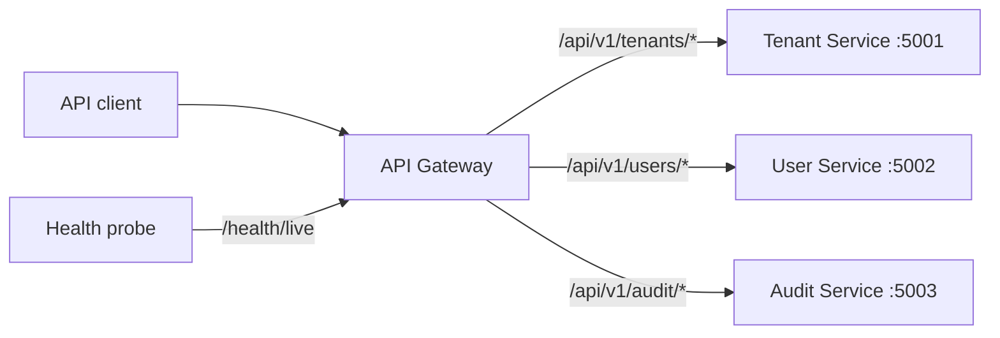

# API Gateway

## Purpose

`CyberConnect.ApiGateway` is the HTTP entry point for backend APIs. It uses [YARP](https://microsoft.github.io/reverse-proxy/) to route versioned API paths to internal services and exposes a liveness endpoint for process checks.

The gateway is intended to be the boundary for cross-cutting concerns such as authentication, authorization, tenant context, correlation IDs, security headers, rate limiting, exception handling, and observability. Those concerns are represented by placeholder files in the project but are not currently registered in the request pipeline.

## Current request flow



`Program.cs` registers YARP from the `ReverseProxy` configuration section, maps `/health/live`, and then maps the reverse proxy. No gateway-specific middleware is currently added to the pipeline.

## Endpoints

| Gateway path | Destination | Match behavior |
|---|---|---|
| `GET /health/live` | Gateway process | Returns HTTP 200 and `{ "status": "ok" }` when the process is running. It does not check downstream services. |
| `/api/v1/tenants/{**catch-all}` | `http://localhost:5001/` | Proxies the matching path to the tenant service. |
| `/api/v1/users/{**catch-all}` | `http://localhost:5002/` | Proxies the matching path to the user service. |
| `/api/v1/audit/{**catch-all}` | `http://localhost:5003/` | Proxies the matching path to the audit service. |

The route definitions use YARP's catch-all parameter. HTTP methods are not restricted by the gateway, so method validation remains the responsibility of the destination service.

## Local development

### Prerequisites

- .NET SDK compatible with `net10.0`
- The downstream services required by the request, listening on ports `5001`, `5002`, and/or `5003`

Start the gateway from the repository root:

```powershell
dotnet run --project .\infra\CyberConnect.ApiGateway\CyberConnect.ApiGateway.csproj --launch-profile http
```

The HTTP launch profile listens on `http://localhost:5015`. The HTTPS profile listens on `https://localhost:7246` and `http://localhost:5015`.

Check liveness:

```powershell
Invoke-RestMethod http://localhost:5015/health/live
```

The development launch settings enable the `Development` environment, but the checked-in development settings currently only configure logging. Proxy destinations therefore remain the addresses in `appsettings.json` unless configuration is supplied through another provider.

## Configuration

Proxy routes and clusters are configured under `ReverseProxy` in [appsettings.json](../infra/CyberConnect.ApiGateway/appsettings.json). Each route selects a `ClusterId`; each cluster contains one or more destination addresses.

To point a cluster at another service instance without editing the file, use the standard .NET configuration hierarchy. For example, this PowerShell command overrides the tenant destination for one process:

```powershell
$env:ReverseProxy__Clusters__tenant-service__Destinations__tenant-service-1__Address = "http://localhost:6001/"
dotnet run --project .\infra\CyberConnect.ApiGateway\CyberConnect.ApiGateway.csproj --launch-profile http
```

Keep the trailing slash on destination addresses so YARP can combine the destination base address with the incoming path consistently.

## Security and trust boundaries

At present, the gateway does not enforce JWT authentication, authorization policies, tenant isolation, rate limits, security headers, or a correlation ID. The NuGet references and placeholder source files indicate planned support, but clients must not treat those controls as active until they are implemented, registered, and covered by tests.

When these controls are implemented, the expected ownership is:

- Authentication: validate the access token at the gateway.
- Authorization: enforce route or policy requirements after authentication.
- Tenant context: derive tenant identity from trusted claims or server-side context; never trust an arbitrary client header.
- Correlation ID: accept a validated incoming ID or generate one, then forward it downstream and include it in responses and logs.
- Security headers: apply headers to gateway responses consistently.
- Rate limiting: constrain abusive or expensive request patterns at the edge.
- Exception handling: return a consistent problem response without leaking internal details.

## Operations

The liveness endpoint is suitable for a process-level liveness probe only. A readiness check should be added separately if deployments need to verify that configured downstream services are reachable before accepting traffic.

The gateway project references OpenTelemetry, Serilog, and HTTP resilience packages, but the current startup code does not configure them. Logging, traces, metrics, retries, timeouts, and circuit breakers should therefore be treated as pending implementation rather than available operational guarantees.

The root Compose files currently define Traefik and platform dependencies, but do not define an API Gateway service. Running the gateway with `dotnet run` is the supported local path until a Compose service is added.

## Related files

- [Program.cs](../infra/CyberConnect.ApiGateway/Program.cs): application startup and endpoint mapping.
- [appsettings.json](../infra/CyberConnect.ApiGateway/appsettings.json): routes, clusters, and destinations.
- [launchSettings.json](../infra/CyberConnect.ApiGateway/Properties/launchSettings.json): local HTTP and HTTPS profiles.
- [CyberConnect.ApiGateway.csproj](../infra/CyberConnect.ApiGateway/CyberConnect.ApiGateway.csproj): target framework and gateway packages.