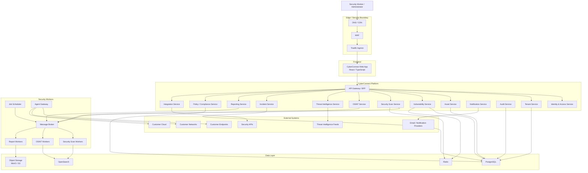
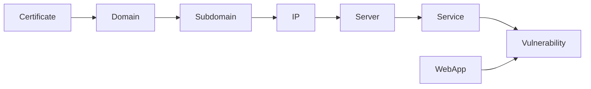
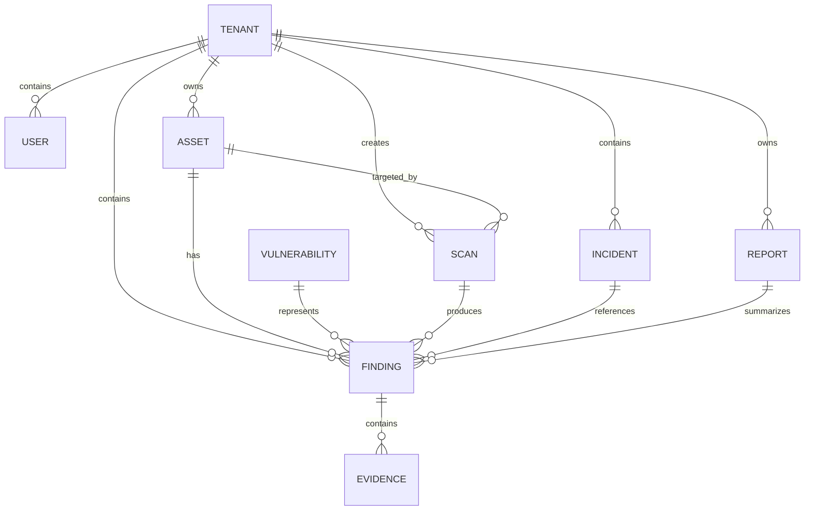
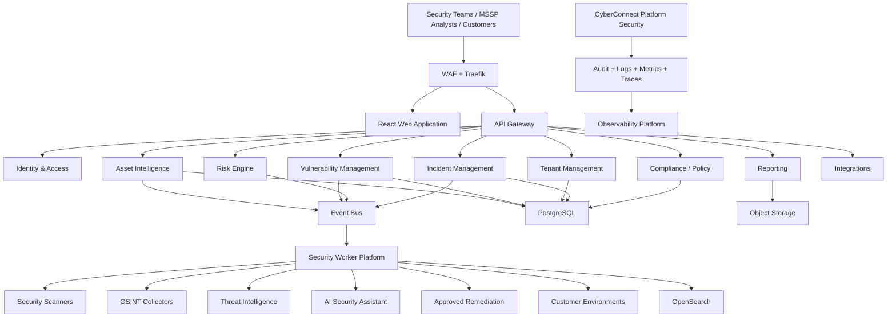

Below is a proposed `architecture.md` designed as the **technical blueprint for CyberConnect**, with security boundaries, microservices, Kubernetes, data flows, observability, worker/agent architecture, and an incremental implementation strategy.

# CyberConnect Architecture

> **Status:** Architecture Blueprint
> **Version:** 1.0
> **Project:** CyberConnect
> **Purpose:** Cybersecurity Operations & Security Management Platform
> **Primary Markets:** Malaysia / Singapore SMEs
> **Architecture Style:** Cloud-native, microservices, Kubernetes, zero-trust oriented

---

## 1. Overview

CyberConnect is a cybersecurity operations platform designed to help security professionals monitor, assess, protect, and report on the security posture of organizations.

The platform should provide capabilities including:

* Asset discovery and inventory
* Vulnerability management
* External attack surface monitoring
* OSINT collection
* Security monitoring
* Endpoint security management
* Patch management
* Configuration assessment
* Security policy/compliance checks
* Threat intelligence
* Security alert management
* Security incident tracking
* Penetration-testing workflow management
* Automated security report generation
* Executive security reports
* Technical security reports
* Customer/security-team dashboards
* Scheduled security assessments
* Security notifications
* Audit logging
* Multi-tenant organization management

CyberConnect should be designed as a **security platform rather than simply a collection of security tools**.

The architecture must therefore prioritize:

1. Security
2. Tenant isolation
3. Least privilege
4. Reliability
5. Auditability
6. Scalability
7. Automation
8. Extensibility
9. Operational simplicity
10. Safe execution of security tools

---

# 2. Architecture Goals

## 2.1 Primary Goals

CyberConnect should:

* Support multiple organizations securely.
* Separate customer data logically and cryptographically where appropriate.
* Allow security workers to manage multiple customers from one platform.
* Support automated and manual security assessments.
* Execute security tools in isolated environments.
* Collect large amounts of security telemetry.
* Normalize security findings from different tools.
* Correlate assets, vulnerabilities, findings, threats, and incidents.
* Generate reports automatically.
* Provide complete audit trails.
* Support asynchronous security workloads.
* Scale individual services independently.
* Support deployment on Kubernetes.
* Support both cloud and on-premise deployments where practical.

---

# 3. Non-Goals

CyberConnect should not initially attempt to become:

* A complete SIEM replacement
* A complete EDR replacement
* A complete firewall
* A complete vulnerability scanner
* A complete SOAR platform
* A complete penetration-testing framework

Instead, CyberConnect should provide an **orchestration, management, intelligence, and reporting layer** that integrates existing security technologies.

---

# 4. High-Level Architecture



---

# 5. Core Architectural Principles

## 5.1 Zero Trust

Every service should assume that other services may be compromised.

Services should authenticate and authorize requests instead of implicitly trusting network location.

```text
Service A
    |
    | authenticated request
    v
Service B
    |
    | authorization check
    v
Resource
```

Do not rely on:

```text
"If request came from Kubernetes internal network,
then it must be trusted."
```

---

# 6. Multi-Tenant Architecture

CyberConnect is expected to manage multiple organizations.

Example:

```text
CyberConnect
│
├── Organization A
│   ├── Users
│   ├── Assets
│   ├── Vulnerabilities
│   ├── Findings
│   └── Reports
│
├── Organization B
│   ├── Users
│   ├── Assets
│   ├── Vulnerabilities
│   ├── Findings
│   └── Reports
│
└── Organization C
    ├── Users
    ├── Assets
    ├── Vulnerabilities
    ├── Findings
    └── Reports
```

Every tenant-owned resource should contain an immutable tenant identifier.

Example:

```text
tenant_id
organization_id
```

The backend must never trust a tenant ID supplied by the browser.

Instead:

```text
JWT
 ↓
Authenticated Identity
 ↓
Tenant Membership
 ↓
Authorization Policy
 ↓
Resource Access
```

---

# 7. Tenant Isolation Strategy

The initial architecture should use:

```text
Shared PostgreSQL
+
Logical tenant isolation
+
Application-level authorization
+
Database-level safeguards where practical
```

Example:

```text
assets
--------------------------------
id
tenant_id
hostname
ip_address
asset_type
created_at
updated_at
```

Every query must include tenant authorization.

Example conceptual query:

```sql
SELECT *
FROM assets
WHERE tenant_id = :authorizedTenantId;
```

Never:

```sql
SELECT *
FROM assets
WHERE tenant_id = :tenantIdFromBrowser;
```

The tenant identity must originate from the authenticated authorization context.

---

# 8. Future Tenant Isolation

As CyberConnect grows, larger customers may require stronger isolation.

Possible architecture:

```text
Tier 1
Shared database
    ↓
Logical tenant isolation

Tier 2
Dedicated schema
    ↓
Customer-specific schema

Tier 3
Dedicated database
    ↓
High-value enterprise customer
```

The platform should abstract the persistence layer sufficiently to allow this evolution.

---

# 9. Identity and Authentication

CyberConnect should use **Keycloak** as the central Identity Provider.

```text
User
 |
 v
Keycloak
 |
 | OAuth 2.0 / OpenID Connect
 v
CyberConnect
```

Keycloak should handle:

* Authentication
* Password policies
* MFA
* Identity federation
* User sessions
* Role assignment
* OAuth/OIDC
* Token issuance
* Account lifecycle

CyberConnect services should not implement their own password authentication.

---

# 10. Authorization

Authentication answers:

> Who are you?

Authorization answers:

> What are you allowed to do?

CyberConnect should use RBAC initially.

Example roles:

```text
PlatformAdmin
SecurityAdmin
SecurityAnalyst
SecurityEngineer
Pentester
IncidentResponder
CustomerAdmin
CustomerSecurityUser
CustomerViewer
Auditor
```

Authorization should eventually support:

```text
RBAC
+
ABAC
+
Tenant scope
+
Resource scope
```

Example:

```text
SecurityAnalyst
    |
    +-- Organization A
        |
        +-- Read vulnerabilities
        +-- Run approved scans
        +-- Generate reports
        +-- Cannot modify billing
        +-- Cannot access Organization B
```

---

# 11. Frontend Architecture

Recommended technology:

```text
React
TypeScript
Vite
```

Possible supporting technologies:

```text
React Router
TanStack Query
Zod
React Hook Form
Tailwind CSS
```

Architecture:

```text
apps/
└── cyber-app/
    ├── src/
    │   ├── app/
    │   ├── auth/
    │   ├── dashboard/
    │   ├── assets/
    │   ├── vulnerabilities/
    │   ├── scans/
    │   ├── incidents/
    │   ├── reports/
    │   ├── osint/
    │   ├── integrations/
    │   ├── settings/
    │   ├── components/
    │   ├── hooks/
    │   ├── services/
    │   └── types/
```

The frontend should never directly access databases or internal services.

```text
React
  |
  v
API Gateway / BFF
  |
  v
Backend Services
```

## Port Usage Convention

To keep local development and deployment predictable, the platform should use a simple port convention aligned with the current Docker Compose setup:

```text
Frontend applications: 3000+
Backend services: 5000+
Public ingress: 80 / 443
Admin / tooling ports: 8080+ / 9000+ / 5601
```

Current Compose ports in use:

```text
Traefik dashboard: 8080
Traefik HTTP: 80
Traefik HTTPS: 443
Keycloak: 8081
OpenSearch Dashboard: 5601
MinIO API: 9000
MinIO Console: 9001
```

Recommended internal service allocation for future platform services:

```text
Frontend (React/Vite): 3000-3099
API Gateway / BFF: 5000
AuthService: 5001
TenantService: 5002
AssetService: 5003
VulnerabilityService: 5004
ScanService: 5005
OSINTService: 5006
ThreatIntelService: 5007
IncidentService: 5008
ReportService: 5009
NotificationService: 5010
AuditService: 5011
PolicyService: 5012
IntegrationService: 5013
```

Future reserved ranges:

```text
Frontend growth: 3100-3999
Backend growth: 5100-5999
Worker / security runtime: 6000-6999
Additional admin tools: 7000-7999
```

In production, public entrypoints may still be exposed through Traefik on standard ports 80/443, while internal service ports remain on the 3000+/5000+ ranges behind the ingress layer. Reserved future ranges are kept separate so the platform can expand without conflicting with current local infrastructure.

---

# 12. Backend Architecture

Recommended primary backend:

```text
.NET / ASP.NET Core
```

Use .NET for:

* API services
* Authentication integration
* Tenant management
* Asset management
* Vulnerability management
* Incident management
* Reporting API
* Administration
* Business workflows

Python should be used where it provides significant advantages for security workloads.

Examples:

* OSINT processing
* Security scanners
* Data analysis
* ML/AI processing
* Threat intelligence enrichment
* Security tool integration
* Specialized parsers

Therefore:

```text
.NET
    = Core business platform

Python
    = Security/data processing workers
```

Avoid creating a microservice simply because another language can be used.

---

# 13. Recommended Service Architecture

Initial services:

```text
services/
│
├── AuthService
├── TenantService
├── AssetService
├── VulnerabilityService
├── ScanService
├── OSINTService
├── ThreatIntelService
├── IncidentService
├── ReportService
├── NotificationService
├── AuditService
├── PolicyService
└── IntegrationService
```

Security execution workers:

```text
workers/
│
├── ScanWorker
├── OSINTWorker
├── ThreatIntelWorker
├── ReportWorker
├── VulnerabilityWorker
└── NotificationWorker
```

---

# 14. Do Not Over-Microservice

Microservices introduce:

* Network failures
* Deployment complexity
* Observability requirements
* Distributed transactions
* Authentication complexity
* Debugging complexity

Therefore the initial implementation should group strongly related functionality.

A recommended evolution:

```text
Phase 1

API
 |
 +-- Identity
 +-- Tenant
 +-- Assets
 +-- Vulnerabilities
 +-- Reports

Workers
 |
 +-- Scan
 +-- OSINT
 +-- Report
```

Then split services when:

```text
Scale requirement
OR
Security boundary
OR
Independent deployment
OR
Team ownership
OR
Different technology requirement
```

justifies the separation.

---

# 15. API Gateway

All external API traffic should pass through a controlled API boundary.

```text
Internet
   |
   v
Traefik
   |
   v
API Gateway / BFF
   |
   +---- Asset Service
   +---- Vulnerability Service
   +---- Scan Service
   +---- Report Service
```

The gateway should handle:

* Authentication token validation
* Request correlation ID
* Rate limiting
* API versioning
* Request size limits
* Security headers
* Routing
* Basic request validation
* Audit context propagation

Business authorization must still be performed by the target service.

---

# 16. API Versioning

Public APIs should be versioned.

Example:

```text
/api/v1/assets
/api/v1/vulnerabilities
/api/v1/scans
/api/v1/reports
```

Avoid breaking existing APIs.

Future:

```text
/api/v2/...
```

---

# 17. Security Scanning Architecture

Security scanning is one of the most sensitive parts of CyberConnect.

Never execute arbitrary security tools directly inside the main API containers.

Bad architecture:

```text
API
 |
 +-- execute nmap
 +-- execute nuclei
 +-- execute scanner
```

Instead:

```text
API
 |
 v
Job Queue
 |
 v
Isolated Scan Worker
 |
 v
Sandbox / Security Tool
 |
 v
Result Parser
 |
 v
Normalized Finding
```

---

# 18. Security Worker Isolation

Each security job should run in an isolated execution environment.

Example:

```text
Scan Job
    |
    v
Job Scheduler
    |
    v
Kubernetes Job
    |
    +-- Dedicated Service Account
    +-- Restricted Network Policy
    +-- Read-only filesystem
    +-- Resource limits
    +-- Timeout
    +-- No privileged mode
    +-- Minimal Linux capabilities
    +-- Ephemeral filesystem
```

Security scanning workers should not have unrestricted access to the Kubernetes cluster.

---

# 19. Scan Authorization

CyberConnect must distinguish between:

```text
Authorized Target
```

and

```text
Unauthorized Target
```

Before a scan is executed:

```text
User
 ↓
Scan Request
 ↓
Authorization Check
 ↓
Target Ownership / Scope Check
 ↓
Policy Check
 ↓
Approval if required
 ↓
Queue
 ↓
Worker
```

For example:

```text
Organization A owns:

example-a.com
10.10.0.0/16
cloud-account-A
```

A worker must reject a target outside the approved scope.

This is critical because CyberConnect is a security platform capable of executing potentially intrusive operations.

---

# 20. Scan Scope Model

Create an explicit scope object:

```text
ScanScope
----------------
id
tenant_id
name
targets
excluded_targets
allowed_ports
scan_profile
authorization_reference
approved_by
valid_from
valid_until
status
```

Possible status:

```text
Draft
PendingApproval
Approved
Running
Completed
Expired
Revoked
```

---

# 21. Scan Profiles

Instead of allowing arbitrary command-line parameters from users, provide predefined profiles.

Example:

```text
PassiveDiscovery
SafeDiscovery
WebAssessment
VulnerabilityAssessment
AuthenticatedAssessment
ComplianceAssessment
```

Each profile defines:

```text
Allowed tools
Allowed options
Timeout
Resource limits
Network restrictions
Concurrency
Data collection level
```

This significantly reduces the risk of command injection and accidental destructive behavior.

---

# 22. Command Execution Security

Never construct shell commands from untrusted strings.

Avoid:

```text
shell("scanner " + userInput)
```

Prefer structured execution:

```text
Executable:
scanner

Arguments:
[
  "--target",
  validatedTarget
]
```

Better still, workers should use predefined tool profiles and structured job specifications.

---

# 23. Asset Management

The Asset Service maintains the authoritative asset inventory.

Asset types:

```text
Domain
Subdomain
IP Address
IP Range
URL
Web Application
API
Server
Endpoint
Container
Cloud Resource
Database
Network Device
Certificate
Identity
SaaS Application
```

Asset relationships:



This asset graph becomes one of CyberConnect's most important data structures.

---

# 24. Vulnerability Management

CyberConnect should normalize findings from different sources.

Example:

```text
Scanner A
Scanner B
Scanner C
Manual Pentest
Threat Intelligence
OSINT
Configuration Assessment
        |
        v
Finding Normalization
        |
        v
Vulnerability Management
```

A normalized finding could contain:

```text
Finding
---------------------
id
tenant_id
asset_id
source
title
description
severity
cvss_score
cve
evidence
recommendation
first_seen
last_seen
status
risk_score
```

---

# 25. Risk-Based Prioritization

Do not rely exclusively on CVSS.

CyberConnect should calculate a contextual risk score.

Conceptually:

```text
Risk =
    Vulnerability Severity
    × Asset Criticality
    × Exposure
    × Exploitability
    × Threat Intelligence
    × Business Impact
```

Example:

```text
Critical vulnerability
+
Internet-facing server
+
Known active exploitation
+
Production system
=
Very High Risk
```

while:

```text
Critical vulnerability
+
Isolated test server
+
No exposure
+
No known exploitation
=
Lower operational priority
```

---

# 26. Threat Intelligence

Threat intelligence should support:

* IOC feeds
* IP reputation
* Domain reputation
* Malware intelligence
* CVE intelligence
* Exploit intelligence
* Threat actor intelligence
* Vulnerability exploitation status

Potential sources:

```text
CVE/NVD
CISA KEV
Vendor advisories
CERT feeds
Commercial feeds
Open-source feeds
Customer-provided intelligence
```

The Threat Intelligence service should normalize external feeds.

---

# 27. OSINT Architecture

OSINT collection should be asynchronous.

```text
OSINT Request
      |
      v
OSINT Queue
      |
      v
OSINT Worker
      |
      +-- Domain intelligence
      +-- Certificate intelligence
      +-- DNS intelligence
      +-- Public exposure
      +-- Public breach indicators
      +-- Search intelligence
      |
      v
Normalization
      |
      v
OpenSearch
```

OSINT workers must respect:

* Legal authorization
* Terms of service
* Rate limits
* Robots/exclusion policies where applicable
* Privacy requirements
* Customer scope

---

# 28. Data Architecture

CyberConnect should use different storage technologies for different workloads.

```text
PostgreSQL
    ↓
Transactional data

Redis
    ↓
Cache / short-lived state

Message Broker
    ↓
Asynchronous jobs

OpenSearch
    ↓
Search / telemetry / security events

Object Storage
    ↓
Reports / evidence / large files
```

---

# 29. PostgreSQL

Use PostgreSQL as the primary relational database.

Store:

* Organizations
* Users/memberships
* Assets
* Vulnerabilities
* Findings
* Scan jobs
* Incidents
* Reports metadata
* Policies
* Integrations
* Audit metadata

Avoid storing huge raw scan outputs directly in PostgreSQL.

---

# 30. Redis

Redis should be used for:

* Cache
* Distributed locks
* Short-lived state
* Rate limiting
* Job coordination where appropriate

Do not treat Redis as the authoritative database.

---

# 31. Message Broker

A message broker should decouple API requests from long-running workloads.

Possible technologies:

```text
RabbitMQ
Kafka
NATS
Azure Service Bus
AWS SQS
```

For the initial deployment, RabbitMQ or NATS is likely sufficient.

Example:

```text
ScanService
    |
    v
scan.requested
    |
    v
ScanWorker
    |
    v
scan.completed
```

---

# 32. OpenSearch

OpenSearch should be used for:

* Security event search
* Scan results
* OSINT data
* Searchable evidence
* Security telemetry
* Aggregation
* Dashboard queries

Do not use OpenSearch as the primary transactional database.

---

# 33. Object Storage

Use MinIO for local/on-premise development and S3-compatible storage in production.

Store:

```text
reports/
evidence/
scan-output/
attachments/
exports/
artifacts/
```

Object storage must use:

* Encryption at rest
* Access policies
* Short-lived signed URLs
* Versioning where appropriate
* Retention policies
* Malware/content validation where applicable

---

# 34. Report Generation

Reports should be generated asynchronously.

```text
User
 |
 v
Report API
 |
 v
Report Job
 |
 v
Report Worker
 |
 +-- Query PostgreSQL
 +-- Query OpenSearch
 +-- Retrieve Evidence
 +-- Generate Document
 |
 v
Object Storage
 |
 v
Signed Download URL
```

Supported outputs:

```text
PDF
HTML
JSON
CSV
```

Potential reports:

```text
Executive Security Report
Vulnerability Assessment Report
Penetration Test Report
Attack Surface Report
Patch Compliance Report
Security Posture Report
Incident Report
Compliance Report
```

---

# 35. Evidence Management

Security evidence should be treated as sensitive data.

Examples:

```text
Screenshots
HTTP responses
Scanner output
Logs
Configuration snapshots
Proof-of-concept evidence
Network information
OSINT results
```

Evidence should have:

```text
tenant_id
asset_id
finding_id
classification
created_at
created_by
hash
storage_reference
retention_policy
```

Where appropriate, calculate cryptographic hashes to provide evidence integrity.

---

# 36. Audit Logging

Every sensitive operation should generate an audit event.

Examples:

```text
User login
MFA change
User creation
Role change
Tenant change
Asset creation
Scan approval
Scan execution
Scan cancellation
Report generation
Evidence access
API key creation
Integration modification
Security policy change
```

Example:

```json
{
  "event": "scan.approved",
  "actor_id": "...",
  "tenant_id": "...",
  "resource_id": "...",
  "timestamp": "...",
  "source_ip": "...",
  "correlation_id": "..."
}
```

Audit logs should be append-oriented and protected against unauthorized modification.

---

# 37. Secrets Management

Do not store secrets in:

```text
Git
Docker images
Kubernetes manifests
Frontend code
PostgreSQL plaintext fields
```

Use:

```text
Kubernetes Secrets
+
External Secrets
+
Vault / cloud secret manager
```

Recommended production architecture:

```text
CyberConnect
      |
      v
Secret Manager
      |
      v
Short-lived credentials
```

Secrets should be rotated regularly.

---

# 38. Kubernetes Architecture

Production deployment:

```text
                    Internet
                       |
                       v
                    WAF/CDN
                       |
                       v
                    Traefik
                       |
        +--------------+--------------+
        |                             |
        v                             v
    Frontend                       API Gateway
                                      |
                         +------------+------------+
                         |            |            |
                         v            v            v
                     Services      Workers      Integrations
                         |
                         v
                  Internal Services
                         |
              +----------+----------+
              |          |          |
              v          v          v
          PostgreSQL   Redis    OpenSearch
                                     
                         |
                         v
                    Object Storage
```

---

# 39. Kubernetes Namespaces

Recommended initial namespaces:

```text
cyberconnect-system
cyberconnect-app
cyberconnect-workers
cyberconnect-security
cyberconnect-data
monitoring
ingress
```

Security workers should be separated from core application services.

---

# 40. Kubernetes Network Policies

Default policy:

```text
Deny all
```

Then explicitly allow:

```text
Frontend
    -> API

API
    -> Required Services

Services
    -> Required Databases

Workers
    -> Required Message Broker

Report Worker
    -> Object Storage
```

Security workers should have extremely limited access.

---

# 41. Kubernetes Security

Containers should use:

```text
Non-root users
Read-only root filesystem where possible
Dropped Linux capabilities
Seccomp
AppArmor/SELinux where available
Resource limits
CPU limits
Memory limits
Pod Security Standards
NetworkPolicies
ServiceAccounts with minimal permissions
```

Avoid:

```text
privileged: true
hostNetwork: true
hostPID: true
hostPath mounts
```

unless there is a documented and reviewed requirement.

---

# 42. Security Worker Kubernetes Policy

Security workers are special because some security tools may require elevated capabilities.

Therefore:

```text
Normal Application Pods
        |
        | Strict security
        v

Security Worker Pods
        |
        | Controlled exception
        v

Specialized Tool Runtime
```

Any elevated capability must be:

1. Explicitly documented
2. Restricted to the smallest possible workload
3. Reviewed
4. Audited
5. Network restricted
6. Resource limited

---

# 43. Customer Agent Architecture

For internal customer environments, CyberConnect can eventually provide an agent.

```text
Customer Environment

+----------------------------+
| Customer Network           |
|                            |
|  Endpoint Agent            |
|       |                    |
|       v                    |
|  Local Collector           |
|       |                    |
+-------|--------------------+
        |
        | outbound TLS
        v
CyberConnect Agent Gateway
```

Prefer outbound connections from customer environments.

Avoid requiring inbound firewall access to customer networks.

---

# 44. Agent Security

Agents should:

* Authenticate using device identity
* Use certificate-based authentication where appropriate
* Use rotating credentials
* Receive signed updates
* Verify update signatures
* Run with least privilege
* Maintain local audit logs
* Restrict command execution
* Support remote revocation
* Use encrypted communication

The platform should not provide unrestricted arbitrary command execution through the agent.

---

# 45. Integration Architecture

CyberConnect should use an adapter architecture.

```text
IntegrationService
       |
       +-- Microsoft 365
       +-- Azure
       +-- AWS
       +-- Google Cloud
       +-- Firewall
       +-- EDR
       +-- Vulnerability Scanner
       +-- Ticketing
       +-- SIEM
       +-- Email
       +-- Threat Intelligence
```

Each integration should expose a normalized internal interface.

Example:

```text
External Vendor API
        |
        v
Vendor Adapter
        |
        v
CyberConnect Normalized Model
```

This prevents vendor-specific logic from spreading throughout the platform.

---

# 46. Observability

CyberConnect must monitor itself.

Use:

```text
OpenTelemetry
Prometheus
Grafana
OpenSearch
```

Collect:

```text
Metrics
Logs
Traces
Security Events
Audit Events
```

---

# 47. Distributed Tracing

Every request should have:

```text
trace_id
correlation_id
request_id
```

Example:

```text
Frontend
   |
trace_id=abc
   |
API Gateway
   |
Asset Service
   |
PostgreSQL
```

This makes debugging distributed security workflows significantly easier.

---

# 48. Application Logging

Never log:

```text
Passwords
Access tokens
Refresh tokens
API keys
Private keys
Secrets
Sensitive customer data
```

Use structured logging.

Example:

```json
{
  "timestamp": "...",
  "level": "Information",
  "service": "ScanService",
  "event": "scan.completed",
  "tenant_id": "...",
  "scan_id": "...",
  "duration_ms": 12345,
  "correlation_id": "..."
}
```

---

# 49. Security Monitoring of CyberConnect

CyberConnect itself must be monitored.

Important security events include:

```text
Repeated authentication failures
Privilege escalation
Unusual administrator activity
Large data exports
Mass asset access
Unusual scan activity
API key creation
API key abuse
Agent registration spikes
Configuration changes
Suspicious service-to-service traffic
```

Eventually CyberConnect should have a dedicated:

```text
Platform Security Monitoring
```

capability.

---

# 50. CI/CD Security

All code should pass through a secured CI/CD pipeline.

Recommended stages:

```text
Developer
   |
   v
Pull Request
   |
   +-- Unit Tests
   +-- Integration Tests
   +-- SAST
   +-- Dependency Scan
   +-- Secret Scan
   +-- Container Scan
   +-- IaC Scan
   +-- CodeQL
   |
   v
Build
   |
   v
Container Image
   |
   +-- Image Scan
   +-- SBOM
   +-- Image Signing
   |
   v
Registry
   |
   v
Deployment
```

---

# 51. Supply Chain Security

Container images should:

* Use pinned versions
* Prefer minimal base images
* Be scanned
* Generate SBOMs
* Be signed
* Be verified before deployment

Recommended technologies may include:

```text
Trivy
Syft
Cosign
GitHub Actions
Dependabot
CodeQL
Gitleaks
```

---

# 52. Infrastructure as Code

Kubernetes infrastructure should be declarative.

Possible structure:

```text
infra/
├── kubernetes/
├── helm/
├── terraform/
├── environments/
│   ├── dev/
│   ├── staging/
│   └── production/
└── policies/
```

Production infrastructure should not depend on manually configured servers.

---

# 53. Environment Separation

At minimum:

```text
Development
Staging
Production
```

Never allow:

```text
Development
    |
    v
Production Database
```

Development credentials and production credentials must be completely separate.

---

# 54. Database Security

PostgreSQL should use:

```text
TLS
Strong authentication
Least-privilege roles
Encrypted backups
Network isolation
Connection limits
Audit logging
Regular patching
```

Application services should not all share the same database credentials.

Prefer:

```text
AssetService DB user
VulnerabilityService DB user
ReportService DB user
```

where practical.

---

# 55. Backup and Disaster Recovery

Critical data:

```text
PostgreSQL
Object Storage
Configuration
Keycloak
Critical security metadata
```

Backups should be:

```text
Encrypted
Automated
Versioned
Monitored
Tested
Off-site
```

A backup that has never been restored is not considered reliable.

Regular restore testing is mandatory.

---

# 56. High Availability

For production:

```text
Multiple API replicas
Multiple worker replicas
Multiple ingress replicas
PostgreSQL HA
Redis HA where required
OpenSearch cluster
Replicated object storage
```

Stateless services should be horizontally scalable.

---

# 57. Asynchronous Architecture

Long-running tasks must not block HTTP requests.

Bad:

```text
POST /scan
    |
    +-- scanner runs 30 minutes
    |
    +-- HTTP request waits
```

Correct:

```text
POST /scan
    |
    v
Create Job
    |
    v
Return 202 Accepted
    |
    v
Queue
    |
    v
Worker
```

Example response:

```json
{
  "job_id": "...",
  "status": "queued"
}
```

---

# 58. Job State Machine

Security jobs should have explicit states:

```text
Created
Queued
Approved
Running
Succeeded
Failed
Cancelled
TimedOut
Rejected
Expired
```

This prevents ambiguous job state.

---

# 59. Rate Limiting

Rate limits should exist at multiple levels.

```text
Internet
    ↓
WAF
    ↓
Ingress
    ↓
API Gateway
    ↓
Service
```

Rate limits should consider:

```text
IP
User
Tenant
API key
Endpoint
Operation
```

Security-sensitive operations should have stricter limits.

---

# 60. Secure File Uploads

Reports, screenshots, evidence, and attachments require strict validation.

Controls:

```text
Maximum file size
Allowed MIME types
Extension validation
Content inspection
Malware scanning
Filename sanitization
Tenant isolation
Object-level authorization
```

Never trust:

```text
filename
Content-Type
file extension
```

supplied by clients.

---

# 61. Data Classification

CyberConnect data should be classified.

Example:

```text
Public
Internal
Confidential
Highly Confidential
Restricted Security Data
```

Security evidence may contain:

```text
Credentials
Internal IPs
Source code
Configuration
Personally identifiable information
Security vulnerabilities
```

Therefore access must be tightly controlled.

---

# 62. Encryption

Data in transit:

```text
TLS 1.2+
Prefer TLS 1.3
```

Data at rest:

```text
PostgreSQL encryption
Object storage encryption
Backup encryption
Secret encryption
```

Highly sensitive evidence may additionally use application-level encryption.

---

# 63. API Security

API protections:

```text
OIDC authentication
RBAC/ABAC
Input validation
Output encoding
Rate limiting
CORS policy
CSRF protection where applicable
Request size limits
Content-type validation
Security headers
API versioning
Audit logging
```

Every API endpoint should have an explicit authorization decision.

---

# 64. Secure Development Lifecycle

Every feature should pass:

```text
Threat Modeling
    ↓
Design Review
    ↓
Implementation
    ↓
Unit Test
    ↓
Integration Test
    ↓
Security Test
    ↓
Code Review
    ↓
Deployment
    ↓
Monitoring
```

Security should not be a final testing phase.

---

# 65. Threat Modeling

Major CyberConnect components should be threat modeled using a methodology such as STRIDE.

Important threats:

```text
Tenant escape
Privilege escalation
Unauthorized scanning
Malicious scan payload
Credential theft
API abuse
Worker compromise
Container escape
Supply-chain attack
Report data leakage
OSINT data leakage
Agent compromise
Kubernetes compromise
Database compromise
```

---

# 66. Critical Trust Boundaries

Important trust boundaries:

```text
Internet
    |
    | TRUST BOUNDARY
    v
CyberConnect

CyberConnect
    |
    | TRUST BOUNDARY
    v
Customer Environment

API
    |
    | TRUST BOUNDARY
    v
Security Worker

Security Worker
    |
    | TRUST BOUNDARY
    v
Target System
```

Every boundary requires explicit authorization and validation.

---

# 67. AI Integration

AI can be added as an assistant layer rather than allowing unrestricted autonomous security actions.

Potential AI capabilities:

```text
Finding summarization
Report generation
Risk explanation
Security recommendations
Log analysis
Alert triage
Threat intelligence summarization
Pentest report drafting
Executive summaries
Natural-language security queries
```

Recommended model:

```text
AI
 |
 v
Read-only security context
 |
 v
Recommendation
 |
 v
Human approval
 |
 v
Security action
```

Do not initially allow:

```text
AI
 |
 v
Unrestricted shell
 |
 v
Internet
```

---

# 68. AI Security Boundary

AI should not automatically receive:

```text
Passwords
API keys
Private keys
Session tokens
Secrets
Unnecessary PII
```

Sensitive information should be redacted before being passed to an AI model where possible.

---

# 69. Human-in-the-Loop Security

Certain operations should require explicit approval.

Examples:

```text
Active vulnerability scan
Potentially intrusive scan
Production security test
Mass scan
Customer-wide remediation
Firewall modification
Endpoint isolation
Automated remediation
```

Example:

```text
AI Recommendation
       |
       v
Security Worker
       |
       v
Approval Required
       |
       v
Authorized Human
       |
       v
Execution
```

---

# 70. Automated Remediation

Automated remediation should initially be limited to low-risk actions.

Examples:

```text
Create ticket
Notify administrator
Generate patch recommendation
Schedule maintenance
Update asset metadata
```

Higher-risk actions should require approval:

```text
Disable account
Change firewall
Restart production server
Deploy patch
Isolate endpoint
Delete resource
```

---

# 71. Event-Driven Architecture

CyberConnect should eventually become event-driven.

Example:

```text
Asset discovered
       |
       v
asset.discovered
       |
       +--> Asset Service
       +--> Vulnerability Service
       +--> Threat Intelligence
       +--> Notification
       +--> Risk Engine
```

Another example:

```text
Critical vulnerability detected
       |
       v
vulnerability.critical
       |
       +--> Risk Engine
       +--> Notification
       +--> Ticket Integration
       +--> Dashboard
       +--> Report
```

---

# 72. Recommended Domain Events

Initial events:

```text
tenant.created
user.created
asset.created
asset.updated
asset.discovered
scan.created
scan.approved
scan.started
scan.completed
scan.failed
finding.created
finding.updated
vulnerability.detected
vulnerability.resolved
incident.created
incident.updated
report.created
report.completed
integration.connected
agent.registered
agent.revoked
```

---

# 73. Domain Model

Core relationships:



---

# 74. Recommended Repository Structure

```text
CyberConnect/
│
├── apps/
│   └── cyber-app/
│
├── services/
│   ├── AuthService/
│   ├── TenantService/
│   ├── AssetService/
│   ├── VulnerabilityService/
│   ├── ScanService/
│   ├── OSINTService/
│   ├── ThreatIntelService/
│   ├── IncidentService/
│   ├── ReportService/
│   ├── NotificationService/
│   ├── AuditService/
│   ├── PolicyService/
│   └── IntegrationService/
│
├── workers/
│   ├── ScanWorker/
│   ├── OSINTWorker/
│   ├── ThreatIntelWorker/
│   └── ReportWorker/
│
├── infrastructure/
│   ├── kubernetes/
│   ├── helm/
│   ├── terraform/
│   └── policies/
│
├── deploy/
│   ├── dev/
│   ├── staging/
│   └── production/
│
├── scripts/
│
├── docs/
│
├── tests/
│
├── .github/
│   └── workflows/
│
├── compose.yml
├── compose.override.yml
└── README.md
```

---

# 75. Development Environment

Docker Compose should be used for local development.

Initial infrastructure:

```text
Traefik
PostgreSQL
Redis
RabbitMQ/NATS
OpenSearch
MinIO
Keycloak
```

Application services can then be started individually.

Development architecture:

```text
Developer
    |
    v
Docker Compose
    |
    +-- Traefik
    +-- Keycloak
    +-- PostgreSQL
    +-- Redis
    +-- RabbitMQ/NATS
    +-- OpenSearch
    +-- MinIO
    +-- CyberConnect Services
```

Kubernetes should be introduced locally when the Kubernetes-specific behavior needs testing.

---

# 76. Production Deployment Model

A recommended production topology:

```text
                    Internet
                       |
                    CDN/WAF
                       |
                    Traefik
                       |
                +------+------+
                |             |
             Frontend       API
                              |
                +-------------+-------------+
                |             |             |
             Services       Queue        Agents
                |             |
                |          Workers
                |
        +-------+--------+
        |       |        |
    PostgreSQL Redis  OpenSearch
                       |
                    Object Storage
```

---

# 77. Deployment Strategy

Use:

```text
Rolling deployments
Health checks
Readiness probes
Liveness probes
Startup probes
PodDisruptionBudgets
Horizontal Pod Autoscaling
```

Critical services should have at least:

```text
2+ replicas
```

where operationally justified.

---

# 78. Release Strategy

Recommended:

```text
feature/*
    |
    v
Pull Request
    |
    v
CI
    |
    v
main
    |
    v
Build
    |
    v
Security Scan
    |
    v
Container Registry
    |
    v
Staging
    |
    v
Security / Integration Tests
    |
    v
Production
```

Production deployment should require controlled approval initially.

---

# 79. Disaster Recovery Targets

Define explicit:

```text
RPO - Recovery Point Objective
RTO - Recovery Time Objective
```

Example initial targets:

```text
RPO: 1 hour
RTO: 4 hours
```

These should be adjusted according to customer contracts and actual infrastructure capability.

---

# 80. Performance Strategy

Performance-critical paths:

```text
Dashboard queries
Asset search
Vulnerability search
Finding search
Security event search
Report generation
```

Use:

```text
Pagination
Caching
Database indexes
OpenSearch
Asynchronous jobs
Background processing
Connection pooling
Read replicas where required
```

Never return thousands of records from an API by default.

---

# 81. Scalability Strategy

Scale components independently.

Example:

```text
100 customers

API:
3 replicas

Scan Workers:
10 replicas

Report Workers:
3 replicas

OSINT Workers:
5 replicas
```

Workers can scale based on queue depth.

```text
Queue depth increases
        |
        v
HPA/KEDA
        |
        v
More workers
```

---

# 82. Security Operations Workflow

Typical vulnerability workflow:

```text
Asset Discovery
      |
      v
Asset Validation
      |
      v
Security Assessment
      |
      v
Finding
      |
      v
Normalization
      |
      v
Risk Calculation
      |
      v
Prioritization
      |
      v
Remediation
      |
      v
Verification
      |
      v
Resolved
```

---

# 83. Pentest Workflow

```text
Customer Authorization
        |
        v
Scope Definition
        |
        v
Rules of Engagement
        |
        v
Approval
        |
        v
Reconnaissance
        |
        v
Assessment
        |
        v
Evidence Collection
        |
        v
Finding Validation
        |
        v
Risk Assessment
        |
        v
Report Generation
        |
        v
Customer Review
        |
        v
Remediation
        |
        v
Retest
```

CyberConnect should preserve the authorization and scope information associated with the engagement.

---

# 84. Security Report Architecture

Reports should be generated from normalized security data rather than directly from scanner output.

```text
Scanner
   |
   v
Raw Result
   |
   v
Parser
   |
   v
Normalized Finding
   |
   v
Risk Engine
   |
   v
Report Engine
   |
   v
PDF / HTML
```

This makes reports consistent across different tools.

---

# 85. Compliance Architecture

The Policy Service can eventually support:

```text
ISO 27001
SOC 2
CIS Controls
NIST CSF
NIST 800-53
PCI DSS
PDPA
Customer-specific controls
```

Architecture:

```text
Control
   |
   +-- Requirement
   |
   +-- Evidence
   |
   +-- Assessment
   |
   +-- Finding
   |
   +-- Remediation
```

Compliance should be implemented as a separate domain rather than hard-coded into vulnerability management.

---

# 86. Security Maturity Roadmap

## Level 1 — Security Management Platform

```text
Asset Management
Vulnerability Management
Reports
OSINT
Basic Integrations
```

## Level 2 — Security Operations Platform

```text
Continuous Monitoring
Threat Intelligence
Incident Management
Automation
Agents
Ticketing
```

## Level 3 — MSSP Platform

```text
Multi-Tenant SOC
Centralized Monitoring
Customer Portal
SLA Management
Automated Reporting
Security Operations Workflows
```

## Level 4 — Autonomous Security Assistance

```text
AI Triage
AI Investigation
AI Reporting
AI Recommendations
Automated Low-Risk Remediation
Human-approved High-Risk Actions
```

---

# 87. Initial Technology Stack

Recommended baseline:

| Layer               | Technology              |
| ------------------- | ----------------------- |
| Frontend            | React + TypeScript      |
| Backend             | ASP.NET Core / .NET     |
| Security Workers    | Python                  |
| Identity            | Keycloak                |
| API Gateway         | Traefik                 |
| Database            | PostgreSQL              |
| Cache               | Redis                   |
| Message Broker      | RabbitMQ or NATS        |
| Search              | OpenSearch              |
| Object Storage      | MinIO / S3              |
| Containers          | Docker                  |
| Orchestration       | Kubernetes              |
| Metrics             | Prometheus              |
| Dashboards          | Grafana                 |
| Tracing             | OpenTelemetry           |
| CI/CD               | GitHub Actions          |
| Container Registry  | GHCR                    |
| SAST                | CodeQL                  |
| Secret Scanning     | Gitleaks                |
| Dependency Security | Dependabot / equivalent |
| Container Security  | Trivy                   |
| SBOM                | Syft                    |
| Image Signing       | Cosign                  |
| IaC                 | Terraform               |
| Package Management  | Helm                    |

---

# 88. Technology Selection Principles

Technology should be selected based on:

```text
Security
Maintainability
Community support
Operational complexity
Performance
Licensing
Integration capability
Cloud portability
Team expertise
```

Do not introduce a new technology unless it solves a real problem.

---

# 89. Critical Security Rules

The following rules should be treated as architectural requirements.

### Rule 1

Never trust client-supplied tenant identity.

### Rule 2

Never execute arbitrary user-provided shell commands.

### Rule 3

Never execute security scans without authorization and scope validation.

### Rule 4

Never run security tools directly inside core API services.

### Rule 5

Never expose internal databases directly to the Internet.

### Rule 6

Never store plaintext secrets in source control.

### Rule 7

Never allow security workers unrestricted Kubernetes permissions.

### Rule 8

Never allow one tenant to access another tenant's resources.

### Rule 9

Never expose security evidence without authorization checks.

### Rule 10

Never allow AI to perform unrestricted security actions.

---

# 90. Recommended Implementation Order

CyberConnect should be implemented incrementally.

## Phase 1 — Platform Foundation

```text
[ ] Repository architecture
[ ] Docker Compose
[ ] PostgreSQL
[ ] Redis
[ ] OpenSearch
[ ] MinIO
[ ] Traefik
[ ] Keycloak
[ ] React application
[ ] ASP.NET Core foundation
[ ] CI/CD
[ ] Security scanning
```

## Phase 2 — Identity and Tenant Management

```text
[ ] Keycloak integration
[ ] Login
[ ] Logout
[ ] MFA
[ ] Tenant management
[ ] User management
[ ] RBAC
[ ] Audit logging
```

## Phase 3 — Asset Management

```text
[ ] Asset model
[ ] Asset CRUD
[ ] Asset discovery
[ ] Asset relationships
[ ] Asset inventory
[ ] Asset dashboard
```

## Phase 4 — Vulnerability Management

```text
[ ] Vulnerability model
[ ] Finding model
[ ] Scanner integration
[ ] Finding normalization
[ ] CVE mapping
[ ] Risk scoring
[ ] Vulnerability dashboard
```

## Phase 5 — Security Workers

```text
[ ] Message broker
[ ] Job scheduler
[ ] Scan worker
[ ] Worker isolation
[ ] Scope validation
[ ] Job lifecycle
[ ] Scan history
```

## Phase 6 — OSINT

```text
[ ] OSINT service
[ ] OSINT worker
[ ] Domain intelligence
[ ] DNS intelligence
[ ] Certificate intelligence
[ ] External exposure monitoring
```

## Phase 7 — Reporting

```text
[ ] Report service
[ ] Report worker
[ ] PDF generation
[ ] Executive reports
[ ] Technical reports
[ ] Evidence attachment
```

## Phase 8 — MSSP Capabilities

```text
[ ] Customer portal
[ ] Agent
[ ] Ticketing integrations
[ ] Notifications
[ ] SLA tracking
[ ] Security monitoring
[ ] Automated remediation
```

## Phase 9 — Kubernetes Production

```text
[ ] Helm
[ ] Kubernetes manifests
[ ] NetworkPolicies
[ ] Pod security
[ ] Secrets management
[ ] Observability
[ ] HA
[ ] Backup
[ ] Disaster recovery
```

---

# 91. Minimum Viable CyberConnect

The first production-capable version should NOT attempt to implement the entire architecture.

The recommended MVP is:

```text
                    CyberConnect MVP

                         User
                          |
                          v
                       Keycloak
                          |
                          v
                     React Web App
                          |
                          v
                    API / Backend
                          |
          +---------------+---------------+
          |               |               |
          v               v               v
       Tenant          Assets       Vulnerabilities
          |               |               |
          +---------------+---------------+
                          |
                          v
                       Queue
                          |
                +---------+---------+
                |                   |
                v                   v
            Scan Worker        Report Worker
                |                   |
                v                   v
           Security Tool        PDF Report
                                    |
                                    v
                               Object Storage
```

This provides the foundation for the future MSSP platform without prematurely creating dozens of services.

---

# 92. Target End-State

The long-term CyberConnect architecture should become:



---

# 93. Architectural Philosophy

CyberConnect should ultimately follow this model:

```text
                 ┌───────────────────────────────┐
                 │       CYBERCONNECT             │
                 │                               │
                 │   Security Intelligence       │
                 │          +                    │
                 │   Security Automation         │
                 │          +                    │
                 │   Security Operations         │
                 │          +                    │
                 │   Security Reporting          │
                 └───────────────┬───────────────┘
                                 │
            ┌────────────────────┼────────────────────┐
            │                    │                    │
            v                    v                    v
       Discover              Detect               Assess
            │                    │                    │
            v                    v                    v
       Monitor               Analyze              Validate
            │                    │                    │
            └────────────────────┼────────────────────┘
                                 v
                            Prioritize
                                 |
                                 v
                            Remediate
                                 |
                                 v
                             Verify
                                 |
                                 v
                              Report
```

The central concept is that CyberConnect should **connect the entire security lifecycle** rather than becoming another isolated security scanner.

---

# 94. Final Architectural Principles

CyberConnect should be built around these principles:

```text
Secure by Default
Least Privilege
Zero Trust
Tenant Isolation
Human Approval for High-Risk Actions
Asynchronous Security Workloads
Immutable Auditability
Defense in Depth
Observable by Default
Infrastructure as Code
Automated Security Testing
Reproducible Deployments
Minimal Trust
Explicit Authorization
Fail Securely
```

The most important architectural boundary is:

```text
                    BUSINESS PLATFORM
                           |
                           |
                 Explicit Authorization
                           |
                           v
                  SECURITY EXECUTION
                           |
                           |
                 Isolated Environment
                           |
                           v
                    TARGET SYSTEM
```

The **business platform should never directly become the execution environment for potentially dangerous security tooling**.

This separation allows CyberConnect to evolve from a small security-management application into a full MSSP platform while keeping the core system maintainable, auditable, scalable, and safe.
